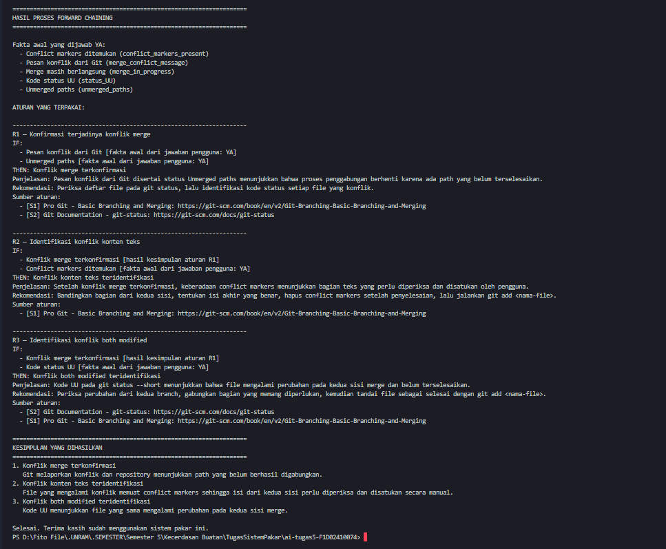
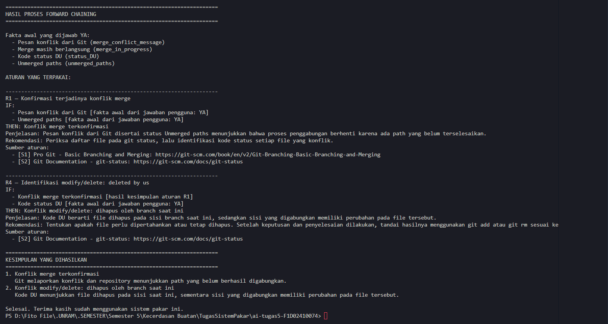
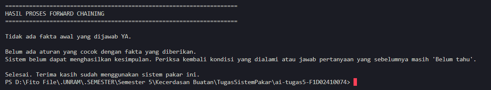
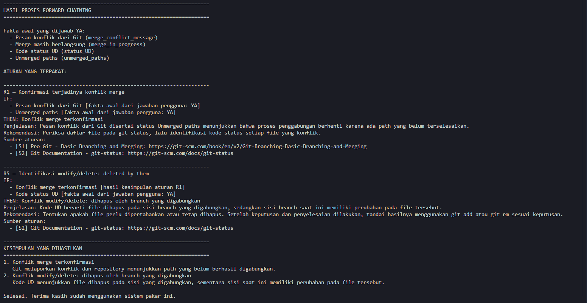

# Sistem Pakar Identifikasi Jenis Konflik dan Rekomendasi Penanganan Merge Conflict pada Git

- **Nama:** Muhamad Fatio Sodirin
- **NIM:** F1D02410074


**Metode:** Forward Chaining  
**Bahasa pemrograman:** Python  
**Basis pengetahuan:** JSON


## 1. Deskripsi Proyek

Proyek ini merupakan aplikasi sistem pakar sederhana untuk membantu pengguna mengenali beberapa jenis konflik yang dapat muncul ketika menjalankan `git merge`. Pengguna menjawab pertanyaan berdasarkan pesan Git, keluaran `git status`, kode status file, dan kondisi proses merge. Jawaban tersebut diproses menggunakan metode **Forward Chaining** untuk menghasilkan identifikasi awal dan rekomendasi penanganan.

Sistem berfokus pada konflik konten (*both modified*) dan konflik *modify/delete*, serta memberikan rekomendasi untuk membatalkan atau melanjutkan proses merge.

## 2. Latar Belakang

Git digunakan untuk mengelola perubahan kode dalam pengembangan perangkat lunak, termasuk ketika beberapa orang bekerja pada branch yang berbeda. Ketika perubahan dari branch digabungkan, Git dapat menemukan konflik yang perlu diperiksa dan diselesaikan oleh pengguna. Contohnya, dua branch mengubah bagian file yang sama atau satu branch menghapus file yang masih diubah pada branch lainnya.

Pengguna yang masih mempelajari Git dapat mengalami kesulitan dalam memahami jenis konflik dan menentukan langkah awal yang perlu dilakukan. Oleh karena itu, proyek ini membuat sistem pakar berbasis aturan yang menghubungkan kondisi yang diamati pengguna dengan identifikasi dan rekomendasi awal.

## 3. Tujuan

1. Mengidentifikasi beberapa kondisi konflik yang terjadi saat proses `git merge`.
2. Memberikan rekomendasi awal berdasarkan fakta yang dimasukkan pengguna.
3. Menampilkan aturan yang digunakan, penjelasan, dan sumber referensi untuk hasil identifikasi.
4. Menerapkan metode Forward Chaining pada basis pengetahuan yang disimpan secara terpisah dalam file JSON.

## 4. Ruang Lingkup dan Batasan

- Sistem membahas identifikasi awal konflik ketika menjalankan `git merge`.
- Jenis konflik yang dibahas meliputi konflik konten (*both modified*) dan konflik *modify/delete* (`DU` dan `UD`).
- Sistem juga menyediakan rekomendasi ketika pengguna ingin membatalkan merge atau melanjutkan merge yang konfliknya sudah diselesaikan.
- Fakta diperoleh dari jawaban pengguna, bukan dengan membaca repository Git secara otomatis.
- Sistem tidak menjalankan perintah Git, mengubah file, atau menyelesaikan konflik secara otomatis.
- Sistem tidak menentukan perubahan kode mana yang benar. Pengguna tetap perlu memeriksa dan menentukan isi akhir file.
- Hasil sistem merupakan identifikasi dan rekomendasi awal berdasarkan jawaban yang diberikan.

## 5. Teknologi yang Digunakan

| Teknologi | Kegunaan |
|---|---|
| Python 3 | Menjalankan aplikasi dan proses inferensi |
| JSON | Menyimpan fakta, kesimpulan, aturan, dan sumber pengetahuan |
| `json` | Modul bawaan Python untuk membaca file JSON |
| Git | Teknologi yang menjadi ruang lingkup kasus yang diidentifikasi |

Tidak diperlukan instalasi library Python tambahan. Program menggunakan modul bawaan Python.

## 6. Metode Forward Chaining

Forward Chaining merupakan metode penalaran yang memulai proses dari fakta awal, kemudian mencocokkan fakta tersebut dengan premis pada aturan IF–THEN. Ketika seluruh premis suatu aturan terpenuhi, kesimpulan aturan ditambahkan sebagai fakta baru ke dalam *Working Memory*. Fakta baru tersebut dapat digunakan untuk memeriksa aturan lainnya. Proses berhenti ketika tidak ada fakta baru yang dapat ditambahkan.

Alur pada aplikasi:

1. Pengguna menjawab pertanyaan dengan `Y` (Ya), `T` (Tidak), atau `B` (Belum tahu).
2. Hanya jawaban `Y` yang dimasukkan sebagai fakta positif ke *Working Memory*.
3. Mesin inferensi memeriksa premis aturan pada `knowledge_base.json`.
4. Jika premis terpenuhi, aturan dijalankan dan kesimpulannya ditambahkan ke *Working Memory*.
5. Pemeriksaan diulang selama masih ada fakta baru.
6. Program menampilkan aturan yang aktif, kesimpulan, penjelasan, rekomendasi, dan sumber.

Dalam proyek ini, operator `AND` berarti seluruh premis harus terpenuhi. Mesin inferensi juga mendukung operator `OR`, meskipun aturan basis pengetahuan saat ini menggunakan `AND`.

### Contoh Rule Chaining

- **R1:** Jika pesan konflik Git ditemukan dan `Unmerged paths` ditemukan, sistem menghasilkan fakta `merge_conflict_confirmed`.
- **R2:** Jika `merge_conflict_confirmed` dan `conflict_markers_present` terpenuhi, sistem menghasilkan kesimpulan konflik konten teks.
- **R3:** Jika `merge_conflict_confirmed` dan kode status `UU` ditemukan, sistem menghasilkan kesimpulan konflik *both modified*.

Hasil R1 digunakan sebagai premis R2 dan R3. Hal tersebut menunjukkan proses *rule chaining* pada Forward Chaining.

## 7. Basis Pengetahuan dan Aturan IF–THEN

Basis pengetahuan disimpan dalam file `knowledge_base.json`. File tersebut berisi 10 fakta masukan, 7 kesimpulan, 7 aturan, dan 3 sumber dokumentasi.

| ID | Kondisi IF | Kesimpulan THEN | Sumber |
|---|---|---|---|
| R1 | Pesan konflik Git dan `Unmerged paths` ditemukan | Konflik merge terkonfirmasi | S1, S2 |
| R2 | R1 terpenuhi dan conflict markers ditemukan | Konflik konten teks teridentifikasi | S1 |
| R3 | R1 terpenuhi dan kode status `UU` ditemukan | Konflik *both modified* teridentifikasi | S1, S2 |
| R4 | R1 terpenuhi dan kode status `DU` ditemukan | Konflik *modify/delete*: dihapus oleh branch saat ini | S2 |
| R5 | R1 terpenuhi dan kode status `UD` ditemukan | Konflik *modify/delete*: dihapus oleh branch yang digabungkan | S2 |
| R6 | Merge masih berlangsung dan pengguna ingin membatalkannya | Rekomendasi `git merge --abort` | S3 |
| R7 | Merge masih berlangsung, semua konflik selesai, dan file sudah di-stage | Rekomendasi `git merge --continue` | S3 |

### Arti kode status yang digunakan

| Kode | Arti dalam konflik merge |
|---|---|
| `UU` | File diubah pada kedua sisi (*both modified*) |
| `DU` | File dihapus pada sisi saat ini (*deleted by us*) |
| `UD` | File dihapus pada sisi yang digabungkan (*deleted by them*) |

Dalam istilah Git, “sisi saat ini” mengacu pada branch yang sedang digunakan, sedangkan “sisi yang digabungkan” mengacu pada branch yang sedang di-merge.

### Sumber Referensi

- **S1 — Pro Git, Basic Branching and Merging:** https://git-scm.com/book/en/v2/Git-Branching-Basic-Branching-and-Merging
- **S2 — Git Documentation, git-status:** https://git-scm.com/docs/git-status
- **S3 — Git Documentation, git-merge:** https://git-scm.com/docs/git-merge

Sumber-sumber tersebut digunakan untuk mendukung penjelasan proses merge, konflik konten, conflict markers, kode status konflik, serta perintah untuk membatalkan dan melanjutkan proses merge. Setiap aturan pada file JSON mencantumkan ID sumber yang menjadi rujukannya.

## 8. Struktur Folder

```text
ai-tugas5-NIM/
│
├── main.py
├── forward_chaining.py
├── knowledge_base.json
├── test_forward_chaining.py
├── README.md
│
└── screenshot/
    ├── pengujian_1_konflik_UU.png
    ├── pengujian_2_konflik_DU.png
    ├── pengujian_3_tanpa_kesimpulan.png
    └── pengujian_4_konflik_UD.png
```

Folder `screenshot` digunakan untuk menyimpan bukti pengujian aplikasi. Nama file gambar di atas merupakan nama yang disarankan; sesuaikan dengan nama file screenshot yang benar-benar dimasukkan ke repository.

## 9. Cara Menjalankan Program

### Persyaratan

- Python 3 terpasang pada komputer.
- Seluruh file program dan `knowledge_base.json` berada pada folder proyek yang sama.

### Menjalankan aplikasi

Buka terminal pada folder proyek, kemudian jalankan:

```bash
python main.py
```

Program akan menampilkan 10 pertanyaan. Jawaban yang dapat diberikan:

- `Y` untuk Ya.
- `T` untuk Tidak.
- `B` untuk Belum tahu.

Hanya jawaban Ya yang dicatat sebagai fakta positif. Jawaban Tidak dan Belum tahu tidak dimasukkan ke dalam *Working Memory*.

### Menjalankan pengujian otomatis

Untuk menjalankan pengujian mesin inferensi, gunakan:

```bash
python -m unittest -v
```

Pengujian otomatis memeriksa rule chaining konflik konten, konflik `DU`, konflik `UD`, rekomendasi membatalkan merge, rekomendasi melanjutkan merge, dan kondisi tanpa aturan yang cocok.

## 10. Skenario Pengujian Aplikasi

Empat skenario berikut digunakan untuk memeriksa keluaran aplikasi. Untuk screenshot, tampilkan bagian hasil proses Forward Chaining yang memuat aturan aktif dan kesimpulan.

### Pengujian 1 — Konflik Konten (`UU`)

**Kondisi:** Dua branch mengubah file yang sama. Setelah proses merge, Git menunjukkan konflik, terdapat `Unmerged paths`, conflict markers ditemukan, dan `git status --short` menunjukkan `UU`.

**Input aplikasi (urut pertanyaan 1–10):**

```text
Y, Y, Y, Y, T, T, Y, T, T, T
```

**Hasil yang diharapkan:** R1, R2, dan R3 aktif. Sistem mengidentifikasi konflik merge, konflik konten teks, dan konflik *both modified*.



### Pengujian 2 — Konflik Modify/Delete (`DU`)

**Kondisi:** Branch saat ini menghapus sebuah file, sedangkan branch yang akan digabungkan mengubah file tersebut. Git menunjukkan kode `DU`.

**Input aplikasi (urut pertanyaan 1–10):**

```text
Y, Y, T, T, Y, T, Y, T, T, T
```

**Hasil yang diharapkan:** R1 dan R4 aktif. Sistem mengidentifikasi konflik *modify/delete* dengan file dihapus pada branch saat ini (*deleted by us*).



### Pengujian 3 — Tidak Ada Kesimpulan

**Kondisi:** Tidak ada kondisi konflik atau kondisi lain yang memenuhi premis aturan.

**Input aplikasi:** Jawab `T` untuk seluruh 10 pertanyaan.

**Hasil yang diharapkan:** Tidak ada aturan yang aktif dan sistem menampilkan pesan bahwa belum ada kesimpulan yang dapat dihasilkan.



### Pengujian 4 — Konflik Modify/Delete (`UD`)

**Kondisi:** Branch yang akan digabungkan menghapus sebuah file, sedangkan branch saat ini mengubah file tersebut. Git menunjukkan kode `UD`.

Untuk membuat kondisi percobaan pada repository terpisah, jalankan perintah PowerShell berikut satu per satu:

```powershell
mkdir uji-merge-ud
cd uji-merge-ud

git init -b main
git config user.name "Tester"
git config user.email "tester@example.com"

Set-Content -Path data.txt -Value "data awal"
git add data.txt
git commit -m "commit awal"

git switch -c fitur-a
git rm data.txt
git commit -m "hapus data dari fitur-a"

git switch main
Set-Content -Path data.txt -Value "data dari main"
git add data.txt
git commit -m "ubah data dari main"

git merge fitur-a
git status --short
```

Kondisi yang diharapkan pada keluaran `git status --short` adalah kode `UD` pada `data.txt`.

**Input aplikasi (urut pertanyaan 1–10):**

```text
Y, Y, T, T, T, Y, Y, T, T, T
```

**Hasil yang diharapkan:** R1 dan R5 aktif. Sistem mengidentifikasi konflik *modify/delete* dengan file dihapus oleh branch yang digabungkan (*deleted by them*).



> Catatan: gambar screenshot harus berasal dari hasil menjalankan program. Gambar contoh atau ilustrasi tidak digunakan sebagai bukti pengujian.

## 11. Hasil Pengujian Otomatis

Pengujian otomatis pada `test_forward_chaining.py` mencakup enam kondisi:

1. Rule chaining R1, R2, dan R3 untuk konflik konten.
2. Identifikasi konflik `DU` melalui R1 dan R4.
3. Identifikasi konflik `UD` melalui R1 dan R5.
4. Rekomendasi pembatalan merge melalui R6.
5. Rekomendasi melanjutkan merge melalui R7.
6. Tidak ada aturan yang cocok ketika fakta awal kosong.

Hasil aktual pengujian dapat diperiksa kembali dengan menjalankan `python -m unittest -v`.

## 12. Penggunaan AI dalam Pengerjaan

Dalam pengerjaan proyek ini, saya menggunakan ChatGPT sebagai alat bantu pembelajaran dan pengembangan sistem pakar. ChatGPT membantu dalam mendiskusikan pemilihan tema, menentukan ruang lingkup permasalahan, memahami dokumentasi Git, merancang struktur basis pengetahuan JSON, serta memberikan penjelasan dan contoh implementasi kode Python menggunakan metode Forward Chaining.

Beberapa bagian kode program dan rancangan aturan IF–THEN juga dikembangkan dengan bantuan ChatGPT sebagai dasar implementasi yang kemudian saya pelajari dan periksa kembali.

Adapun keterlibatan saya dalam pengerjaan proyek meliputi pemilihan dan penentuan tema akhir, pemilihan teknologi Python dan JSON, menyiapkan struktur proyek pada komputer, menjalankan dan mempelajari program melalui Visual Studio Code, meninjau fakta serta aturan berdasarkan dokumentasi Git, dan melakukan percobaan menggunakan repository Git untuk memahami kondisi konflik yang menjadi objek sistem pakar.

Saya juga mempelajari hubungan antara fakta awal, Working Memory, aturan IF–THEN, proses penarikan kesimpulan, serta rekomendasi yang dihasilkan sistem. Hasil implementasi dan pengujian diperiksa kembali agar sesuai dengan tujuan dan ruang lingkup proyek.

Dengan demikian, ChatGPT digunakan sebagai pendamping dalam proses pembelajaran, perancangan, dan implementasi, sedangkan keputusan mengenai arah proyek, proses mempelajari, menjalankan, memeriksa, serta memahami hasil pengerjaan tetap melibatkan saya sebagai mahasiswa.

## 13. Kesimpulan

Aplikasi ini menerapkan sistem pakar berbasis aturan dengan metode Forward Chaining untuk mengidentifikasi beberapa kondisi konflik ketika menjalankan Git merge. Fakta masukan disimpan dalam *Working Memory*, kemudian dicocokkan dengan aturan IF–THEN yang tersimpan dalam JSON. Ketika premis terpenuhi, sistem menghasilkan kesimpulan yang dapat digunakan untuk memeriksa aturan berikutnya. Program menampilkan aturan yang aktif, penjelasan, rekomendasi, serta sumber referensi untuk membantu pengguna memahami hasil identifikasi.